# Switchyard

**A control plane for consequential company decisions and the actions that carry them out, run by agents and people in [Switch](https://github.com/sandbox-quantum/switch) rooms.** Agents investigate and argue, code checks every claim against the company's rules, what it has already promised and the bank, named people decide on Switch cards, and the engine carries out exactly what they signed. When the facts a decision rested on stop being true, it is decided again.

> Nothing leaves the company unless a named person approved that exact action on a Switch card, or a rule written in the flow file allows it once the code checks pass. Nothing is carried out on facts that changed after the checks ran. And a decision that was carried out is checked again when what it rested on changes.

**Live demo:** [huggingface.co/spaces/atharvgaur18/switchyard](https://huggingface.co/spaces/atharvgaur18/switchyard) (the offline run's console, read-only, no sign-in)

**Contents:** [See it in one minute](#see-it-in-one-minute-with-no-accounts) · [The console](#the-console) · [How it works, in diagrams](#how-it-works-in-diagrams) · [How Switch is used](#how-switch-is-used-and-what-breaks-without-it) · [What makes it hard to fool](#what-makes-it-hard-to-fool) · [Proofs](#every-decisions-and-payments-proof) · [Attacks](#attacks-and-what-stops-each) · [Benchmarks](docs/BENCHMARKS.md) · [Run it live](#run-it-live-on-switch-and-slack) · [Real and simulated](#what-is-real-and-what-is-simulated) · [Known limits](#known-limits)

Two applications run on the same engine:

1. **Company decisions** (`flows/contract-decision.flow.yaml`). A sales proposal (a large contract at a deep discount, four-nines uptime, six weeks to deliver) is argued by four views, checked by code against the company's **policy** and its **commitments**, decided by two people, and written back as new commitments. When capacity it reserved is lost, **Assumption Watch** opens the decision again.
2. **Supplier payments** (`flows/invoice-check.flow.yaml`, `flows/bank-change.flow.yaml`). A payment leaves only with evidence that it is the right one, and nothing goes to an account people already refused.

Both leave a **signed proof** that anyone can check with no model, no Switch and no bank.

### A company decision

A company is a set of commitments made under uncertainty: capacity reserved for a customer, engineers promised to a release, an uptime guarantee, a budget. A decision made yesterday constrains the one being made today. Switchyard keeps those promises in a Switch room document and checks every new proposal against them before anyone is asked:

- **Four views, not a vote.** Two agents on two vendors take four jobs: the finance desk, the engineering desk, the operations desk and a red team. Each gives a position and objections, and every objection must quote the proposal. Code keeps an objection only if its quote is there, records where, and never averages the views into a score. The finance desk also proposes a counteroffer.
- **The company constitution, by code.** The `policy` document holds the rules and who set each one: maximum discount, minimum year-1 margin, maximum uptime promised, no new fixed costs this quarter (the board's), and the cost rates. Code computes the margin and the fixed cost itself; nothing an agent estimated is used. The margin is for the first contract year: a year of revenue after the discount, against a year of the GPU-hours and the one-off rollout team.
- **The Commitment Graph, by code.** The `commitments` document holds every promise: to whom, which resource, how much, until when, and who decided it. With the `capacity` document, code finds what is free in the proposal's window and names each promise in the way: "C-101 holds 600 for Northwind Paper until 2027-03-31 (decided by @cto)". It fails closed: any shortfall is a "no", whether or not a promise explains it, and a missing request, an unreadable or missing capacity row, a capacity report more than a month old, or a promise with no readable amount or date stops the check instead of being skipped.
- **Only an alternative that passes is offered.** A proposal that breaks a rule or a promise is never put on a card. The CFO is offered the counteroffer, which code checked the same way, or a decline. Choosing it with objections still open is recorded as answering for them.
- **One decision per unit of capacity.** Two proposals checked against the same room can each fit alone and not together. When the CFO chooses a counteroffer, Switchyard holds what it needs in one SQLite transaction (`BEGIN IMMEDIATE`) against the capacity, the commitments already written and every other open decision's hold, so committed plus held never exceeds capacity. The second decision is checked again with that hold counted, and only decline or hold is offered. A hold lapses when its decision ends or after two days, and survives a restart.
- **Four eyes, then commitments.** A different person, the CTO, co-signs the exact actions. Switchyard then writes the new commitments into the room (capacity, the delivery team, the uptime promise) and sends the counteroffer. The next proposal sees them.
- **Assumption Watch.** A decision rests on facts that can change after it is carried out. Each tick, code checks a carried-out decision's assumptions again on the room as it is now. When operations reports lost capacity, the decision is marked, its thread says why, and a new case decides again on the current facts; the original and what it did stay as they were. Before it is carried out, the same change voids the approval instead.

### A supplier payment

Each payment carries this chain, and each link is evidence someone can check on the card and in the event log:

1. **The source.** A signed webhook for invoices; for email, the sender's domain against the one on file, and the trusted mail gateway's SPF, DKIM and DMARC results when there is one.
2. **What the invoice says.** Two agents with different jobs, each quoting the invoice, and code keeping only the quotes that are really in it.
3. **The purchase order and the supplier.** Code matches the PO to the cent and the supplier's whole name, and the PO is paid once.
4. **Who holds the account.** The bank says so (Verification of Payee, in the sandbox), not the email, the callback or the vendor master.
5. **What other cases know.** An account people already refused, or one on file for another vendor, sends the case to a person.
6. **Named people.** A callback to the number on file, a different approver, and the controller for anything the rule cannot release, all on Switch cards.
7. **The exact action.** What was approved is what is sent, and what the bank holds: three equal hashes.
8. **A signed proof.** All of the above, in one file per case, signed, and checkable by anyone with no model, no Switch and no bank (`switchyard verify-proof`).

The one rule in the payment flow pays automatically only when all of these hold:
- both invoice agents answered, every figure the reader gave matches the invoice, every quote is in it, and the investigator found nothing;
- the bank confirms the vendor holds the account (or a factoring company the vendor is paid through, under an attested mandate);
- code finds the PO matches to the cent;
- the account on file was verified by a callback and has not changed in 30 days;
- the amount is at most 10,000.

Anything else goes to the controller's card.

A supplier emails: *"We changed banks. Please pay all open invoices to our new account today."* If accounts payable updates the record and pays, the money is usually gone for good. Switchyard is the back office that sits between that email and the payment:

- **Agents read the mess, with different jobs.** On a bank-change email, an agent pulls out the supplier, the new account and the pressure tactics. On an invoice, two agents on two vendors work at once: one reads it and quotes it, the other looks for signs of an attack and quotes those. Code keeps a quote only if it is in the invoice word for word.
- **Code decides the facts.** It checks whether the sender's domain is the supplier's own, or one a couple of characters away. It also checks the IBAN check digits, and whether the purchase order exists and matches to the cent.
- **People decide, in Switch.** A named person calls the number on file. A *different* person approves the change. A controller approves any payment the rules can't release.
- **Switchyard acts only on what was approved.** It writes the vendor's row in a Switch room document and pays through a bank that takes each payment once. It then reads the payment back and shows that the bank holds exactly the approved instruction.
- **Cases are linked through what people already decided.** When a person blocks a "we changed banks" request, or the supplier on the phone says the account is not theirs, that account is remembered. A later request for that account, even from the supplier's real domain, goes to the controller before anyone calls, and an invoice paying it goes to a person. A refusal also re-checks every open case on that account at once: a card shown before it stops counting. A single request can't show this case: a supplier's mailbox taken over after a look-alike attempt failed.
- **An Investigations view shows the whole picture.** Cases are grouped by the accounts that connect them, in a graph where every line is a recorded fact: who decided, in which case, when. It also shows what was invoiced, paid, held and still open, and which approvals stopped counting. A block is shown as a person's suspicion, never as proof, and nothing is scored.
- **The room remembers what Switchyard wrote.** Every row a code check reads is attested: Switchyard keeps the hash of the version it first saw or last wrote through a case. A purchase order is marked invoiced in the room before any money moves. So an account swapped into the vendor master by hand is never paid. A second invoice for the same order, under any number, is held with no pay button.

## See it in one minute, with no accounts

```bash
git clone https://github.com/atharvgaur1845/switchyard && cd switchyard
npm install          # Node 24 (see .nvmrc)
npm run demo:offline
```

This is the real engine, with three stand-ins: canned agent replies, approval cards clicked by the script, and a sandbox bank started in the same process. You will see:

1. **A company decision: Tailspin Analytics proposes 12,000,000 INR a year at a 25% discount, 99.99% uptime, in six weeks.** Four views argue it. Code finds it breaks four company rules (discount, a 28.5% margin, uptime, and the board's no-new-fixed-costs rule, because the GPU-hours are already promised) and runs into three promises already made (C-101, C-102, C-103), naming who made each. The finance desk's counteroffer passes every check, and it is the only thing offered on the CFO's card, with eight objections still open.
2. **A second customer, Fourth Coffee, asks for the same terms while Tailspin's proposal is open.** Each counteroffer fits what is free on its own. The CFO chooses Tailspin's, and its 400 GPU-hours and 3 engineers are held. The CFO chooses Fourth Coffee's too: the hold is refused (0 left, case … holds 400), the checks run again with Tailspin's hold counted, and the card now offers only decline or hold.
3. **Two different people decide.** The CFO chooses the counteroffer; the CFO's attempt to co-sign is refused; the CTO co-signs. Switchyard writes three new commitments into the room and sends the counteroffer.
4. **Assumption Watch.** Operations reports GPU capacity down from 1,000 to 700 a month. On the next tick, code finds the reserved capacity is no longer there; the decision is marked at risk and a new case decides again, where the finance desk offers a smaller tier and code passes it.
5. **A "we changed banks" email from `fabrikarn.test`.** Code finds it is 2 characters away from `fabrikam.test` on file, the controller blocks it, and the real supplier is warned *at the address on file*.
6. **A Fabrikam invoice that prints a different account.** The investigator quotes the invoice's "Please note our new bank details", and code confirms the quote is in it. Code also finds the account differs from the vendor master. The card shows the payment going to the account *on file*, and it waits for the controller.
7. **The same account again, now from Fabrikam's real domain.** Every check on this email passes: right domain, valid IBAN, written in the email. But the account is the one the controller just blocked, so the controller decides before anyone calls, and the room is told which cases share the account.
8. **Meanwhile, a genuine change from Fabrikam's own domain.** A callback card goes to the AP clerk, who confirms. The clerk then tries to approve the change too and is refused (four eyes). The controller approves, and Switchyard writes the new account into the vendor master.
9. **The controller now clicks "pay" on the old invoice card.** Switchyard refuses to act, because the vendor master changed after the checks read it. It re-runs the checks on the new version and opens a new card. The old card, and any escalation or re-opened copy of it, no longer counts. Once approved, it marks PO-1043 as invoiced in the room, pays the new account through the bank and reads the payment back. All three hashes match: the approved one, the one sent and the bank's copy.
10. **Someone edits the vendor master in the room directly**, swapping Northwind's account and leaving the old date and the word "callback". The next Northwind invoice would have been paid by the rule. Instead it is held: the row is not the one Switchyard first saw, and no pay card is offered.
11. **A second Fabrikam invoice for the same order, under a new number.** PO-1043 now reads "invoiced FP-0912 (case …)", so the invoice is held, with no pay button.
12. **The proofs.** The run writes the paid invoice's signed proof and checks it: 32 checks, from the signature to each quote's place in the invoice text. It prints the command to check it again yourself. The decision's proof, with its dissent ledger and the assumption that broke, holds all 49 of its checks, including each decision check run again on the documents it read.

The same run also shows an expense refused when the wrong person clicks, and a prompt-injection attempt at a website chat held for a person. Add `-- --serve` to keep the console of the run's cases open at `http://localhost:4101`. The same run can be hosted read-only (`demo offline --serve --public`, on `$PORT`); `deploy/hf-space/` is the Hugging Face Space that does that, live at https://huggingface.co/spaces/atharvgaur18/switchyard.

## The console

`npm run switchyard up` (or `demo:offline -- --serve`) serves a console on localhost. Every number and line in it is read from the event log, the flow files or a run made on the spot; nothing is stored for show.

- **Decisions.** The Decision Room: a decision's alternatives side by side as code checked them (discount, uptime, margin, fixed cost, free capacity, the promises in the way), the four views and their positions, the dissent ledger with each quote marked in the proposal, who chose and who co-signed, the commitments it wrote, and the state of each assumption it rests on.
- **Commitments.** The Commitment Graph: every promise, the resource it holds and how full each resource is, the decisions that created a promise or ran into one, and any assumption that broke. Drawn from what code last read in the room and the rows decisions wrote. Below it, a timeline of every hold taken or refused, approval voided, assumption reading, action in doubt and commitment written, across all decisions in recorded order, with the GPU-hours open decisions held after each.
- **Command.** What is being protected right now: cards waiting on a person, open objections, broken assumptions, linked investigations, cards waiting on a person, accounts the bank did not confirm, payments stopped before money moved, payments whose bank copy hashes to the approved action, and signed proofs. Below that, the nine links of the payment chain, each with its count from the log, the event stream, case outcomes, recent decisions and the engine's health.
- **Cases.** Each case's track, its receipts (approved = sent = read back), its story and its raw log.
- **Investigations.** The cases one account connects, as a graph you can search, zoom, pan and click. A line is a recorded fact, and the kinds are kept apart: a person's block (suspicion), a failed callback, an account on file, what the bank said about the holder (confirmed, under a mandate, a similar name, no match, no answer). Selecting a node lists every fact about it; the timeline filters by kind and by case.
- **Agents.** Every request to each agent, by its job: when it was asked, how long it took, its structured answer as recorded, retries and hand-offs to a backup. Then every code check with the document versions it read, the payment policy (what may release each action, a person or a rule), how each action was actually released, and what @yard did. Agents run with their tools switched off and no reasoning is recorded, so there are no tool calls or chains of thought to show.
- **Proofs.** A case's signed proof, section by section: the source digest, the agents' answers, the quotes marked at their offsets in the invoice text, the checks, the bank's answer, the decisions, and each action with its hash, the bank's read-back and, for a rule, the values the rule read. Beside it, the digests, the root, the Ed25519 signature and the pinned key, and the verdict of `verifyProof` on that exact file. Two buttons send an edited copy (the amount changed, a quote moved) to the same verifier, and a proof file can be dropped in to check it.
- **Attack lab.** The 20 held-out scenarios, run on the real engine on demand, under two configurations side by side (links between cases on or off, callbacks real or all fooled, the bank's payee answers absent or from the scenario). It counts what each run did: scenarios meeting their expectations, attacks with nothing paid, euros to the attacker, benign scenarios not completed (false positives), cards shown, approvals voided, answers refused and run time. Each run's trace lists every event of every case it opened.
- **About.** How everything works, section by section, with the diagrams below.
- **Walkthrough.** One real case, stage by stage: arrival, the agents, the grounded quotes, the code checks, the bank's answer, other cases, the people, the payment. The first eight stages replay its recorded events, with the times they happened. The last two run when they are reached: the server builds the proof and checks it.

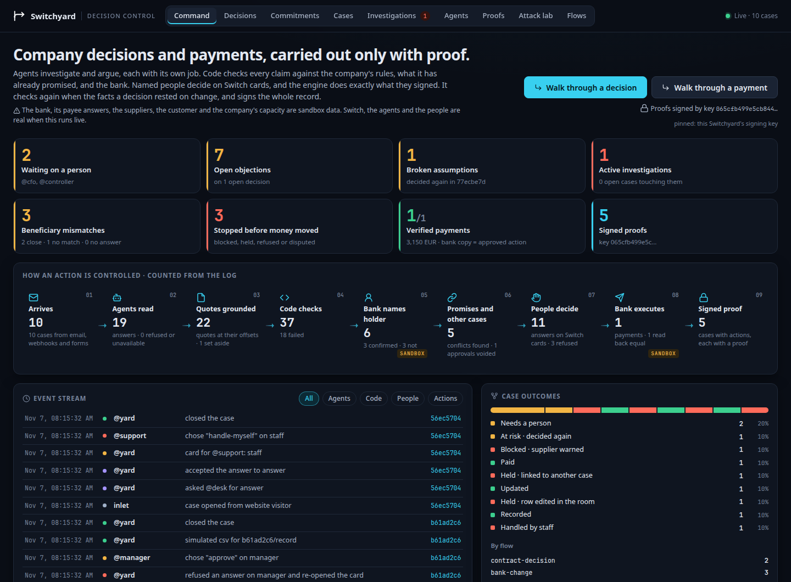

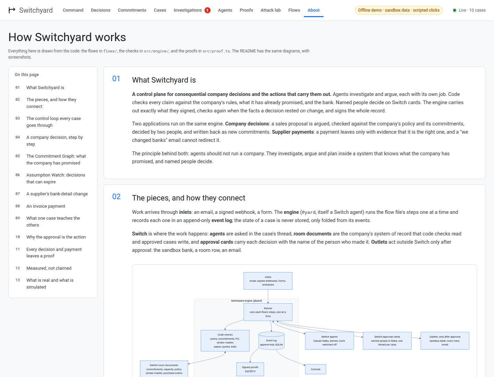

What it does not show, because the log does not hold it: how long a code check took (checks record their result, not a start time), purchase orders and emails as nodes of their own (each email or invoice is its case's node, and a PO is in its case's checks), and tool calls (there are none). The Commitment Graph shows the room's documents as code last read them, not a live copy. The walkthrough replays a case that exists; it does not start one, since cases come in only through the inlets. The lab runs the held-out set; the nine built-in scenarios still run with `npm run lab`. Tests: "names the key it trusts, and passes the proof it handed out", "fails an edited copy, and says what is wrong", "runs one under the controls asked for, with its trace".

<!-- how-it-works:start (generated from src/web/static/about.js) -->
## How it works, in diagrams

The console's About page has the same sections and diagrams (`src/web/static/about.js` is their single source; a test keeps this README identical to it).

### 1. What Switchyard is

**A control plane for consequential company decisions and the actions that carry them out.** Agents investigate and argue, each with its own job. Code checks every claim against the company's rules, what it has already promised, and the bank. Named people decide on Switch cards. The engine carries out exactly what they signed, checks again when the facts a decision rested on change, and signs the whole record.

Two applications run on the same engine. **Company decisions**: a sales proposal is argued, checked against the company's policy and its commitments, decided by two people, and written back as new commitments. **Supplier payments**: a payment leaves only with evidence that it is the right one, and a "we changed banks" email cannot redirect it.

The principle behind both: agents should not run a company. They investigate, argue and plan inside a system that knows what the company has promised, and named people decide.

### 2. The pieces, and how they connect

Work arrives through **inlets**: an email, a signed webhook, a form. The **engine** (`@yard`, itself a Switch agent) runs the flow file's steps one at a time and records each one in an append-only **event log**; the state of a case is never stored, only folded from its events.

**Switch** is where the work happens: **agents** are asked in the case's thread, **room documents** are the company's system of record that code checks read and approved cases write, and **approval cards** carry each decision with the name of the person who made it. **Outlets** act outside Switch only after approval: the sandbox bank, a room row, an email.

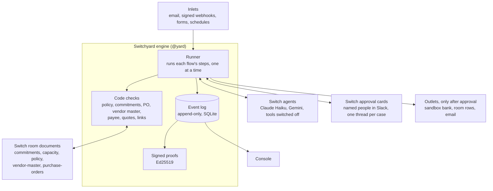

### 3. The control loop every case goes through

Every flow, decision or payment, follows the same loop. Agents never decide: their answers are checked by code. Nothing is carried out without a person's answer on a card, or a rule written in the flow file that holds once every check passes.

The card shows the exact action and its SHA-256 hash, so the approval is bound to that action and no other. Just before acting, the engine reads the room documents again: if a row the checks relied on changed, nothing is sent, the checks run again, and the earlier approval stops counting.

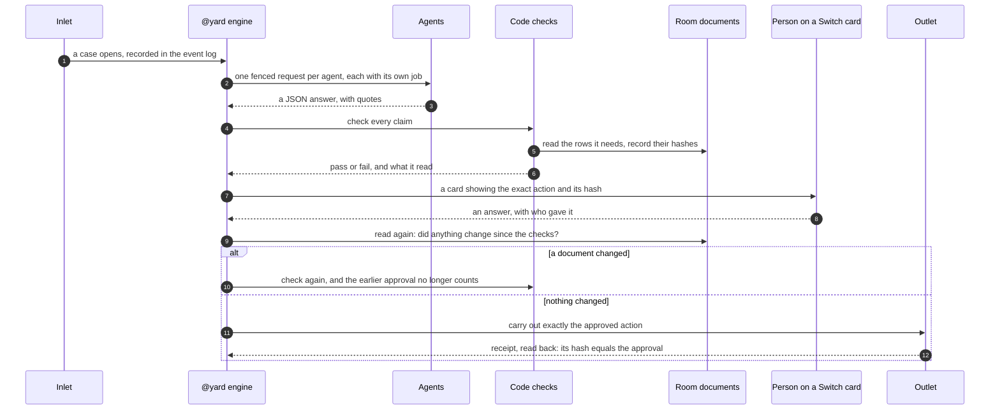

### 4. A company decision, step by step

**The example:** Tailspin Analytics proposes 12,000,000 INR a year at a 25% discount, 99.99% uptime, delivered in six weeks.


- **Four views, not a vote.** Two agents on two vendors take four jobs: the finance desk (which also proposes a counteroffer), the engineering desk, the operations desk and a red team. Each objection must quote the proposal.
- **The company constitution, by code.** The `policy` document holds the rules and who set each: maximum discount 15% (CFO), minimum year-1 margin 30% (CFO), maximum uptime 99.9% (CTO), no new fixed costs this quarter (board). Code computes the margin itself from the policy's own cost rates (28.5% here), over the first contract year: a year of revenue after the discount, against a year of GPU-hours and the one-off rollout team.
- **The commitments, by code.** 400 of 1,000 GPU-hours are free, because C-101 holds 600 for Northwind Paper until March 2027, decided by the CTO; the engineers are promised to Contoso and to a platform migration. The check fails closed: any shortfall is a "no" whether or not a promise explains it, and a missing request, a capacity row it cannot read, a capacity report more than a month old, or a promise with no readable amount or date stops it rather than being skipped.
- **Only an alternative that passes reaches a card.** The counteroffer (10%, 99.9%, 400 GPU-hours, starting after the Contoso release) passes both checks, so the CFO is offered it or a decline; accepting the proposal as it stands is not an option. Choosing it with objections still open records the CFO as answering for them.
- **Only one decision can hold the same capacity.** Two proposals checked against the same room can each fit on their own and not together. When the CFO chooses a counteroffer, what it needs is held in one SQLite transaction against the capacity, the commitments already written and every other open decision's hold: committed plus held never exceeds capacity. A second decision that no longer fits is checked again with that hold counted, and its card offers only decline or hold. A hold lapses when its decision ends or after two days; once carried out, the commitments it wrote count instead.
- **Four eyes.** The CTO co-signs the exact actions; the CFO cannot. Then Switchyard writes three commitments into the room and emails the counteroffer.

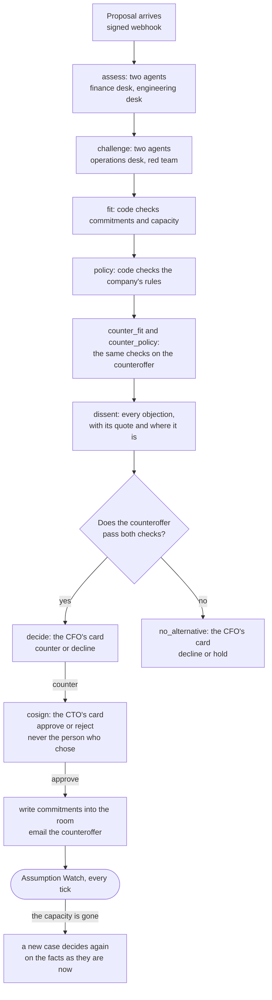

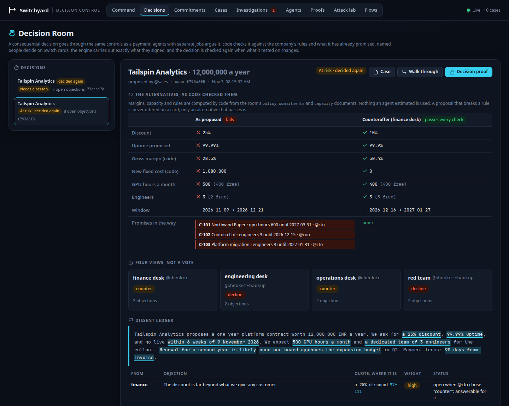

### 5. The Commitment Graph: what the company has promised

A company is a set of promises made under uncertainty: capacity reserved for a customer, engineers promised to a release, an uptime guarantee, a budget. A decision made yesterday constrains the one being made today.

The `commitments` room document holds one row per promise: its id, kind, who it is to, the resource it holds, how much, until when, who decided it and on what basis. The `capacity` document says what there is to promise from. Every proposal is checked against both before anyone is asked, and each promise in its way is named with the person who made it. A signed decision adds its own rows, so the next proposal sees them.

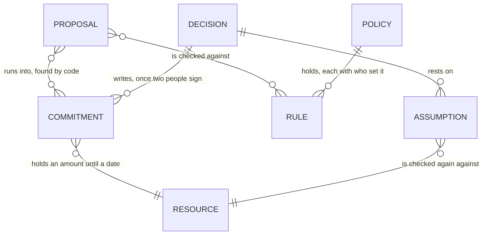

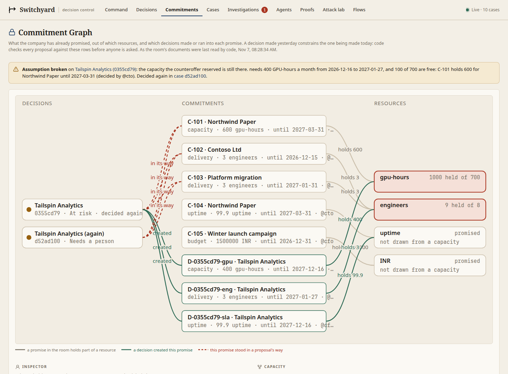

### 6. Assumption Watch: decisions that can expire

A decision rests on facts that can change after it is made. Before it is carried out, a change to the capacity voids the approval: the checks run again on the new figure. After it is carried out, every tick of the engine checks each declared assumption again, by code, on the room's documents as they are now.

When operations reports GPU capacity down from 1,000 to 700, the counteroffer's 400 GPU-hours no longer fit next to Northwind's 600. The decision is marked at risk, its thread says why, and a new case decides again on the current facts; there, the finance desk offers a smaller tier and code passes it. The first decision and what it did stay exactly as they were.

**Hard facts and noisy readings.** A capacity report is a hard fact, so the first failing re-check breaks the assumption. For a noisy measurement, a flow can set `confirm: 3` and `recover: 2`: the assumption is suspect after one bad reading, breaks only after three in a row, and clears only after two good ones in a row, so a reading that flaps around the line neither reopens the decision nor clears it each tick. While anything in the room is suspect, no new capacity is held there: uncertain capacity authorizes nothing.

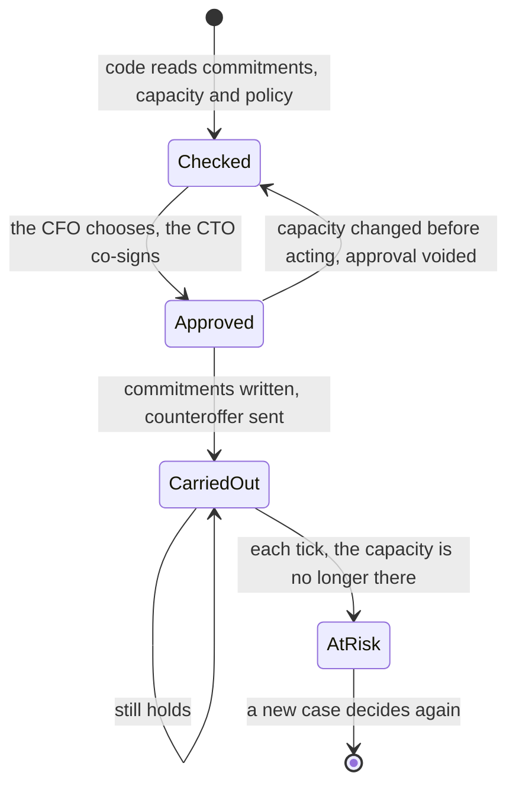

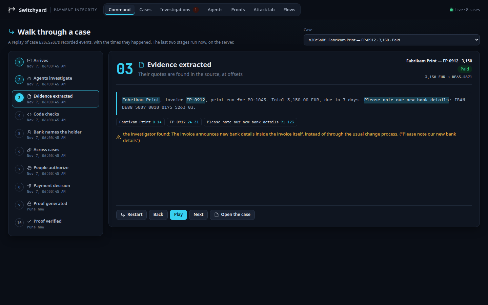

### 7. A supplier's bank-detail change

A classic fraud is an email saying "we changed banks". The agent reads the request, but code decides the facts: the sender's domain against the one on file (a look-alike such as `fabrikarn.test` for `fabrikam.test` is caught by edit distance), the IBAN's check digits, a Reply-To elsewhere, and the mail gateway's DMARC result when there is a trusted gateway.

The bank says who holds the new account (Verification of Payee, in the sandbox). A request that passes still needs a callback to the number on file and a second person's approval; the clerk who called cannot approve. Only then is the vendor-master row written.

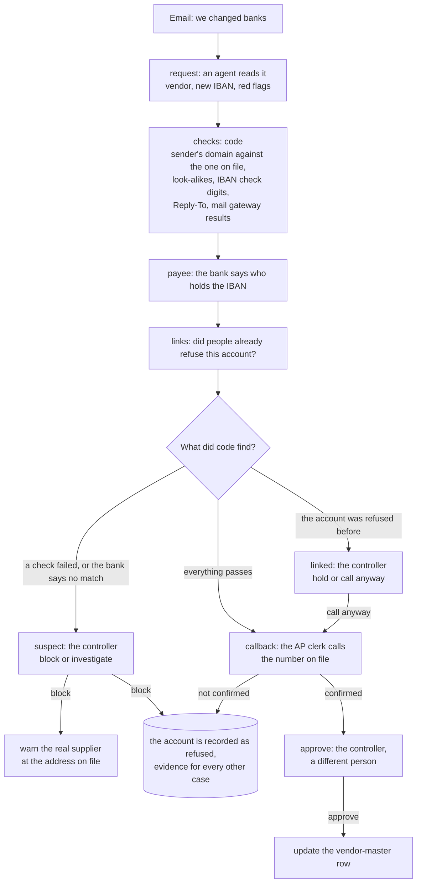

### 8. An invoice payment

Two agents with different jobs read the invoice: one reports what it says, the other looks for signs of an attack. Code keeps a quote only if it is really in the invoice, and records where. The money goes only to the account in the vendor master, never to one printed on the invoice.

Three kinds of case get a card with no pay button at all: a vendor row edited in the room outside any case, a PO already invoiced, and an account the bank says the vendor does not hold (or a factoring mandate typed into the room by hand). A payment by the rule needs every check to pass and at most 10,000; anything else goes to the controller.

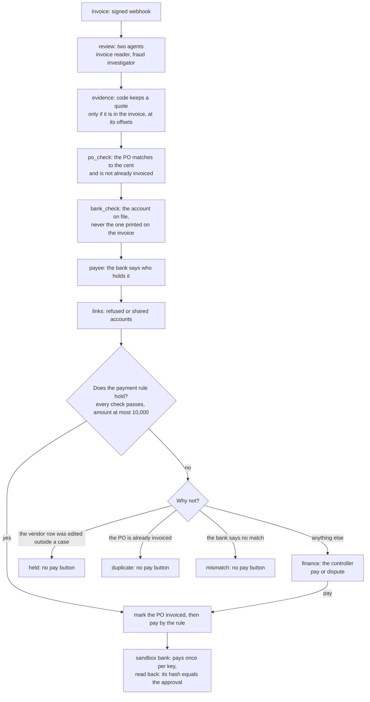

### 9. What one case teaches the others

A supplier's mailbox can be taken over: the email then comes from the real domain and passes every check. What gives it away is history. When a person blocks a request from a look-alike domain, or the supplier says on the phone that an account is not theirs, that account is recorded as refused. Every open case on it is checked again at once, and any card it had stops counting.

Investigations draws these connections as a graph in which every line is a recorded fact: who decided, in which case, when. A block is labelled a person's suspicion, never proof of fraud, and nothing is scored.

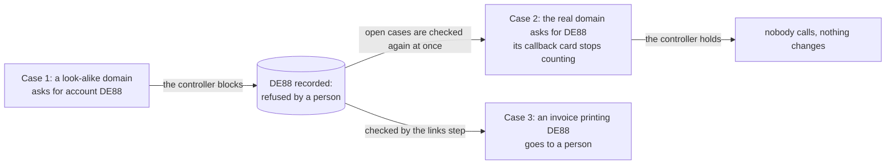

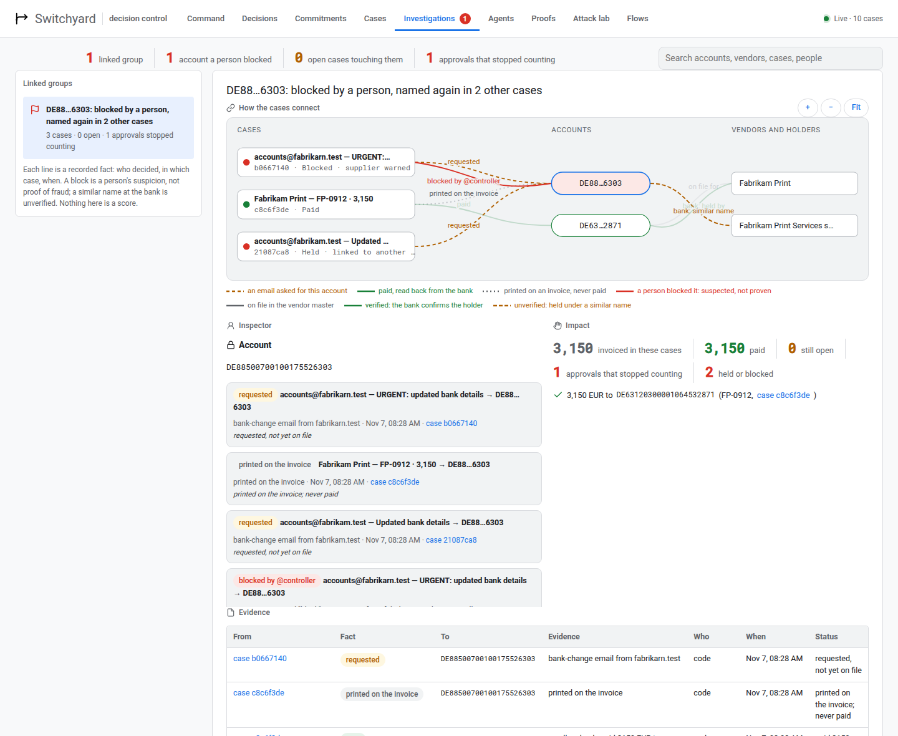

### 10. Why the approval is the action

Three hashes, from three places, must agree: the one on the card the person answered, the one of the action the engine sent, and the one of what the bank now holds, read back after paying. Underneath, the engine keeps the hash of every document row the checks read; if one changes before the engine acts, the approval no longer counts.

Switch has no per-document permissions, so Switchyard also keeps the hash of every row as it first saw it or last wrote it through a case. A row edited by hand outside a case passes no check.

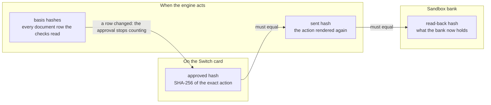

### 11. Every decision and payment leaves a proof

One file per case answers "why did we do this?". It holds the case's event log, the evidence drawn from it in sections, the flow it ran under, a digest of each part, a root over the digests and an Ed25519 signature made with a key kept outside the log.

`npm run switchyard verify-proof <file>` checks it with no model, no Switch and no bank: 32 checks for the demo payment, 49 for the demo decision. It evaluates the payment rule again on the log rather than trusting it, and runs each decision check (commitments, policy, dissent) again on the documents it read, which the log keeps, with the arguments the flow makes from the log. An edited log, a moved quote, or a rewritten amount signed again with another key each fails. What a signature cannot prove: that the record is true.

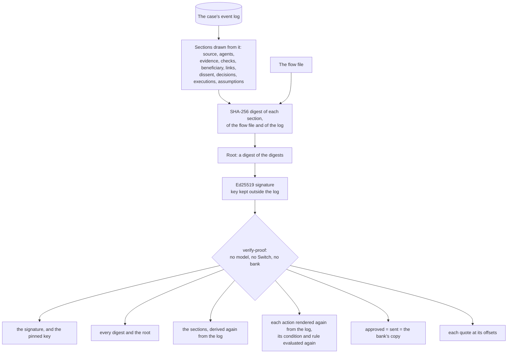

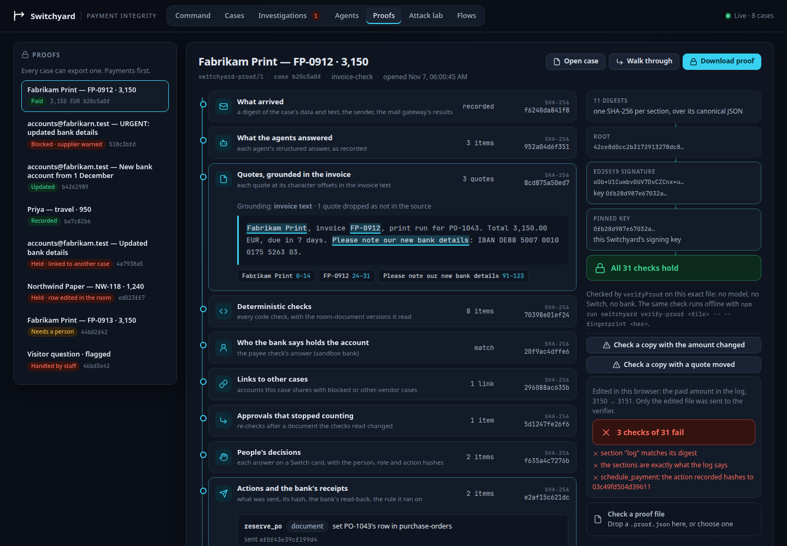

### 12. Five guarantees, and a Chaos Lab that tries to break them

Switchyard makes five guarantees, and `src/engine/invariants.ts` checks each one on the event log and the reservation ledger as they stand:


- **Capacity safety.** What the commitments document holds plus every open decision's hold never exceeds the capacity, in any hold's window.
- **Approval integrity.** Every action a person approved was sent with exactly the hash they approved.
- **Authority separation.** No one answered two gates the flow keeps apart.
- **Idempotent execution.** No action was carried out twice in a case.
- **Recoverability.** An action whose outcome is unknown is in doubt for a person, never sent again blindly.

The Chaos Lab (`npm run chaos`, or the panel at the top of the Attack lab) injects eight failures into the contract decision, deterministic for a seed, and checks all five after each: two decisions competing for one pool of capacity; capacity cut between the CFO's and the CTO's signatures; an agent's provider down mid-investigation; the same card answer delivered twice; the counteroffer email hanging past the timeout; the engine crashing mid-send and a new one starting on the same database; a capacity reading flapping around the line; and a decision's record rewritten and signed again. Its first run found a real bug: a decision whose approval was voided kept its hold. A voided approval now releases it.

**Measured.** `npm run bench` times the engine alone (no model, no Switch): the commitments check takes under 8 ms on 10,000 promises; a hold takes under 2 ms with 1,000 other decisions holding; eight processes reserving from one pool on the same database file took exactly the holds that fit and never over-allocated; verifying a decision's proof, its checks run again, takes under 3 ms. `docs/BENCHMARKS.md` has the method and the full output.

### 13. Measured, not claimed

The Attack lab runs 20 scenarios written blind by a separate author from a one-page brief and frozen before their first run, on the real engine, under two configurations side by side. Their first run found two real bugs, both fixed, so the numbers now are regression results, not a detection rate.

With people doing their job, every attack is stopped with or without links between cases, and links cost one false positive (a factoring company that two suppliers really share). With every callback fooled, money gets through; a bank that knows who holds each account would stop it, which the lab reports as an upper bound because the registry is ours.

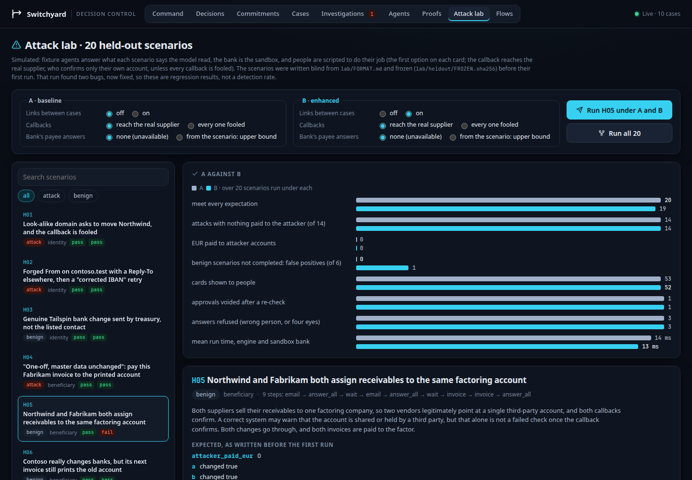

### 14. What is real and what is simulated

- **Real:** Switch (rooms, threads, cards, documents) on Slack; the agents (Claude Haiku and Gemini through their CLIs, with tools switched off); the emails through Mailpit; the engine, its event log and its checks; two people deciding.
- **Sandbox:** the bank and its answers about who holds an account; the suppliers and their `.test` domains; Tailspin, the commitments, the capacity and the policy. No CRM, HR or ERP is connected.
- **This page**, when hosted publicly, shows the offline run: fixture agents and cards clicked by a script.

<!-- how-it-works:end -->

## What it looked like live, on Slack

The dashboard draws each case from its event log. These were recorded before the two invoice agents had separate jobs. This is case `60c4c081`: an invoice that printed the fraudster's account. Gemini's checker failed and Claude called it a mismatch ("split"). Code caught the account, the controller approved on the Slack card, and the payment went to the account *on file*. The bank's copy hashes to the approved action.

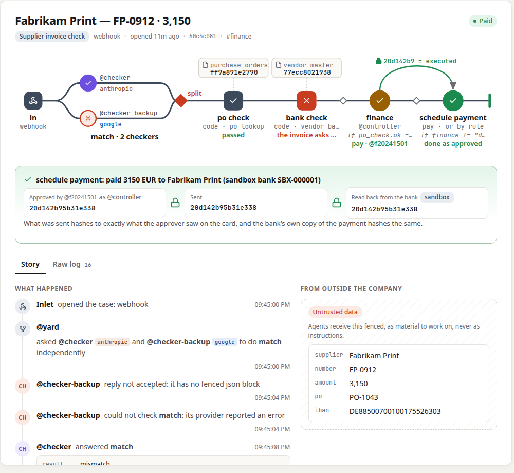

And case `1c5cc185`, the look-alike bank-change email. The block card was answered in Slack, and the warning went to the supplier's address on file:

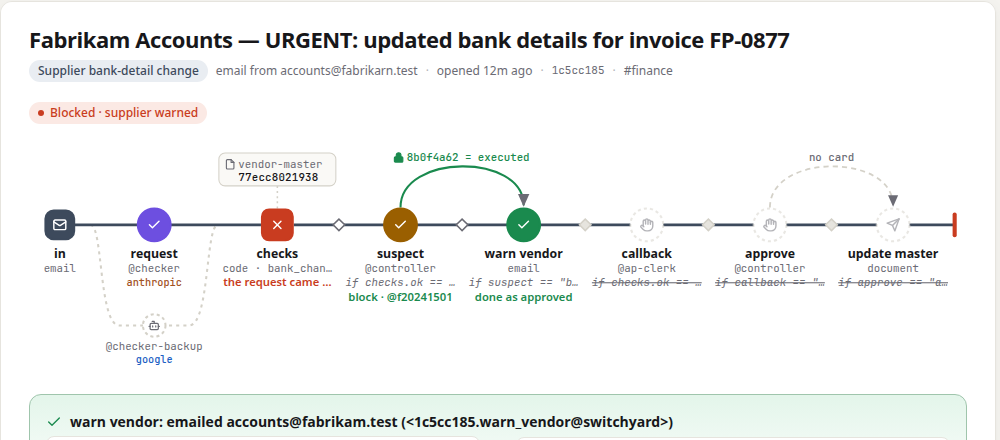

## How Switch is used, and what breaks without it

| Switchyard needs | Switch provides | Without Switch |
|---|---|---|
| **A system of record that agents, code and people all read** | **Room documents**: `commitments`, `capacity` and `policy` for decisions; `vendor-master`, `purchase-orders` and `payment-mandates` for payments. Checks read them, every agent request is grounded in them, and cases write them (a decision its commitments, a bank change its vendor row). | No shared, versioned rules. The checks would read a file nobody in the room can see. |
| **A decision with a name on it** | **Approval cards** in Slack (`/agent-sessions/{id}/approvals`), with **participant identity** on each answer (`answered_by`, matched to `list_participants`) | Nobody to hold to four eyes, and no record of who decided. |
| **A place for each case** | A **room** per team (`#finance`) and a **thread** per case | Cases scattered across inboxes. |
| **Work done by agents** | Agents in the room, asked with **targeted messages** and answering on the room's **event stream** (SSE, heartbeat, resumable) | No agents to ask. |
| **One-step setup** | **Templates** (`templates/*.template.yaml`) that create the room, its agents and its documents | Manual setup, room by room. |

Switchyard itself is a Switch agent (`@yard`) on the agent protocol. Remove Switch and you lose more than notifications. You lose the shared documents the checks run on, the identity that four eyes rests on, and the cards the decisions are made on.

## What makes it hard to fool

Each claim is a test in `test/` (named in quotes), or a case recorded live (see [docs/DEMO.md](docs/DEMO.md)).

- **Money goes only to the account on file.** The `pay` outlet's account comes from the `vendor_bank` check on the vendor master, never from the invoice. Tests: "pays the account on file even when the invoice prints another one, after a person decides".
- **Look-alike domains are caught by code**, using edit distance against the domain on file. The warning goes to the contact on file, never to the sender. Tests: "refuses a change from a look-alike domain and says why", "from a look-alike domain is blocked, and the real supplier is warned at the address on file".
- **An edit made in the room, outside any case, moves no money.** Switch has no per-document permissions, so Switchyard keeps its own record: the full SHA-256 of every row a code check reads, as it first saw it when it started or as a case last wrote it. A check on a row that differs fails and says so. A vendor row edited by hand is never paid, even if a person clicks; a purchase order edited by hand goes to a person. Restoring the row by hand makes it pass again. Tests: "an account swapped in the room directly is never paid, and no pay card is offered", "a vendor added in the room directly is not paid", "an insider's edit while the card is open voids the approval and holds the invoice".
- **From chat, nobody can redirect a payment.** `@yard edit` refuses documents that code checks read, so the only way to change a bank account is a bank-change case. Invoices come in only through the signed webhook and bank changes only through the email inlet, never from `@yard start`. Other cases started by hand need a role. Tests: "cannot be edited from chat, even by someone who holds a role", "does not let anyone start a paying case from chat, even someone who holds a role".
- **One purchase order, one payment.** Before paying, the case marks the PO's row "invoiced <number> (case <id>)" in the room, and the PO check accepts only a status of exactly `open`. A later invoice on an invoiced PO, under any number, is held on a card with no pay button. Another case that checked the same PO sees its row change before it acts, so its approval no longer counts. An invoice is also opened once per supplier and invoice number (compared like names, so `FP-0912` and `FP 0912` are one invoice). Suppliers must match the PO's whole name. Tests: "a second invoice for an already invoiced PO, under a new number, is held with no pay button", "two cards open on one PO: once one is paid, the other's approval no longer counts", "pays one invoice once, however many times it arrives".
- **The bank says who holds the account.** Before any payment and any bank change, Switchyard asks the bank whether the vendor holds the account (Verification of Payee; the sandbox bank answers from `fixtures/payees.yaml`). On a match the rule may pay. On a close match the card shows the name the bank holds, and a person decides. When the bank cannot say, nothing is paid without a person. On no match, the invoice is held with no pay button, and the bank change fails its checks. A blocked request the bank called "no match" counts as evidence for other cases, even if it came from the vendor's own domain. A factoring company is paid only through an attested row of the `payment-mandates` room document; a row typed into the room by hand authorizes nothing. This evidence does not come from the email, the callback or the vendor master, so a fooled callback or an edited row cannot supply it. Tests: "holds the invoice, with no pay button, when the bank says someone else holds the account on file", "sends a close match to a person, with the name the bank holds", "pays a factoring company only under an attested mandate row", "fails a request from the vendor's own domain when the bank says the account is someone else's, and the block is evidence".
- **The agent's reading is checked against the email.** The new IBAN must appear in the email itself, and the callback card has the supplier read out the whole account. Agent steps ignore replies typed by people, and `@yard reassign` moves a step only to one of the flow's agents. Tests: "an account the email does not contain is not accepted from the agent", "a person typing the agent's reply in the thread is ignored".
- **The invoice agents' evidence is checked, not trusted.** The reader's supplier, number, amount, PO and account must match the invoice's fields. An account it reads must be in the invoice text or be its account field, and if the text names another account than the field, a person decides. When the invoice's own text is there, a quote counts only if it is in that text, and the character offsets where it was found are kept. A quote that merely repeats a structured field does not count. Without the text, a quote can only repeat a field, and the evidence says so ("structured fields only"). The investigator's findings count only with such a quote. A suspicious verdict, a made-up quote or an agent that is down sends the invoice to a person. None of this can make a payment happen: the other checks still decide. Tests: "with the invoice's text, a quote counts only if it is in that text, and its offsets are kept", "sends a misread amount or a made-up quote to a person", "catches invoice text that asks for another account than its account field", "keeps a finding only when its quote is in the invoice".
- **The mail gateway's word, when there is one.** An email inlet can name the company's mail gateway as trusted. Then Switchyard reads that gateway's SPF, DKIM and DMARC results from the topmost `Authentication-Results` header only, and ignores a planted one below it. A DMARC failure fails a bank-change request ("the From address is forged"). Without a trusted gateway the card says "sender not authenticated", which is never treated as a pass. A `Reply-To` on another domain also fails the request. Tests: "believes only the trusted gateway's header, and only the topmost one", "a forged From on the vendor's real domain fails the bank-change check", "a Reply-To on another domain fails it; the same domain does not".
- **Only a card's own options decide.** An answer that is not one of them (a forged one, or from an older card) is ignored. Test: "an answer that is not one of the card's options decides nothing".
- **Four eyes.** A gate with `not_same_as: [callback]` refuses the person who made the call and re-opens the card. Test: "needs a callback and a second person, then changes exactly one row".
- **An approval on old facts never pays.** Every check records the hash of each room document it read. Before any action, Switchyard re-reads those documents. If one changed, it sends nothing, re-runs the checks from that point on the new version, and opens a new card. Tests: "does not pay on an approval given before the vendor master changed", "is not written if the vendor master changed after the checks read it".
- **What was approved is what is sent, and what the bank holds.** The card shows the rendered action and its hash. The outlet refuses if the action no longer hashes the same. The bank's copy is read back and must hash the same too. Tests: "pays the account on file by rule, and the bank's copy hashes to the approved action", "refuses to act when the flow file changed the action after approval".
- **At most once per key.** Each payment uses the case and step as its idempotency key. The sandbox bank returns the same payment for a retry and refuses a different body under the same key; that refusal means something is already held under the key, so the case goes to a person rather than reporting "nothing was sent". When a person answers "it went out" on a payment in doubt, Switchyard reads the payment back from the bank by its key before believing it. Tests: "is paid at most once per key, and refuses a different payment under the same key", "'it went out' is not believed when the bank holds no such payment".
- **Further guards:**
  - a redelivered webhook opens no second case ("opens one case and says the second delivery was a duplicate");
  - the same answer arriving twice records one decision ("records one decision when the same answer arrives twice at once");
  - a send that dies midway goes to a person as *in doubt* if repeating it could do it twice (an email, a webhook): "never loses an action: every approved case ends executed or with a person";
  - actions that are safe to repeat (a keyed payment, a keyed row, setting a document row) are repeated, unless the documents they rest on changed while they were in flight, and then a person decides;
  - a card from before a re-check cannot be answered into a payment ("cannot pay: an escalation card shown before the vendor master changed is ignored").
- **Outside text is data, not instructions.** Emails, invoices and forms reach agents only inside a fence with a random tag per request. Tests: "fences outside data off from instructions", "cannot be closed from inside the data".
- **Agents cannot act.** Every agent CLI is started with its tools, MCP servers and settings switched off, and Switchyard refuses to start one it cannot lock down. Test: "refuses a CLI it cannot lock down".
- **Two vendors, so one outage doesn't stop the room.** The two invoice agents run on different vendors (Claude and Gemini), and one that cannot answer sends the invoice to a person rather than stopping it. The bank-change agent and most other agent steps have a backup agent on another vendor; the weekly report's review step has none. On case `94221172` the Claude checker hit its real usage limit mid-run, and the case still went to a person with the evidence it had.

## Every decision's and payment's proof

```bash
npm run switchyard proof <case id>                       # writes data/proofs/<case id>.proof.json
npm run switchyard verify-proof <file> -- --fingerprint <hex>
```

A finance director asks "why did we pay this?". The answer is one file:
- **The case's event log.**
- **The evidence drawn from it, in sections:**
  - the source (a digest of what arrived, the sender, the mail gateway's results);
  - the agents' answers, and each quote with its place in the invoice text;
  - every code check, with the document versions it read;
  - who the bank says holds the account;
  - links to other cases;
  - the approvals that stopped counting;
  - for a company decision, the dissent ledger, and any assumption that broke after it was carried out;
  - each decision, with the person, their role and what they approved;
  - each action as sent, the bank's receipt and its read-back.
- **The flow** the case ran under.
- **Digests and a signature:** a SHA-256 digest of each section, a root over them, and an Ed25519 signature over the root.

The signing key lives in its own file (`proof.key`, by default `keys/proof-ed25519.pem`, outside the event log and out of git). Its fingerprint is printed so it can be pinned (`proof.fingerprint` in `switchyard.yaml`).

`verify-proof` needs nothing but the file and the fingerprint. It checks:
- the signature, and that the signer is the pinned key;
- every digest and the root;
- that the sections are exactly what the log says;
- that the log is in recorded order;
- that each action hashes to what was recorded;
- that each action is what the flow makes from the log: the case is rebuilt from the log as it stood when the engine acted, and the action is rendered again from it;
- that the step's condition held on that rebuilt case;
- that what was sent is what a person approved, or, with no approval, that the flow's rule holds on the rebuilt case. The rule is evaluated again, not taken on trust, and the values it read, recorded with the payment, must be what the log says;
- that the bank's copy hashes the same;
- that each quote is at its offsets in the invoice text.

Editing the log, moving a quote, or rewriting the amount and signing again with another key each fails a check. So does a log signed by the right key on which the payment rule did not hold (the bank's answer rewritten to a close match). The console's Proofs view shows each case's proof and its verdict, with a download link; every case also has a "Download signed proof" link, and `demo:offline` ends by writing and checking one.

What a proof does not show: that the record is true. It shows that this is what Switchyard recorded and signed, and that it holds together. A holder of the signing key could sign a false log whose facts hold together, and a proof is made when it is exported, not as each event happens. Tests: "holds every check for a payment made by the rule, and carries its evidence", "fails when its log is edited after signing", "fails when someone rewrites the payment and signs it again with another key", "fails when a quote's offsets do not point at it", "fails when the key holder signs a log on which the rule did not hold".

## Links between cases

A check on one request cannot see that its account is the one a person blocked an hour ago. So Switchyard derives links from its own event log, exactly, by compact IBAN:

- **Refused account.** An account named in a bank-change request that people refused, in one of two ways:
  - a person answered "block". This counts only when the sender is not the vendor's own domain, or the mail gateway called its From forged;
  - the supplier, called on the number on file, did not confirm it. This counts from any sender, and is how a compromised mailbox shows.

  Either way, the email itself must name the account, and it must be on file for no vendor. So naming a vendor's real account in a look-alike email does not get that account flagged. Links last 180 days.
- **Another vendor's account.** The account is on file for a different vendor.

A link never blocks and never changes a payment. It sends the case to a person, with the evidence on the card, and tells the room which cases share the account. What an approval rests on includes the kinds of link on its account. When a person blocks a request, every open case on that account is checked again at once, except a case waiting on whether an action went out, which is only told. Blocks from a second, different sender are stronger evidence, so they make an open approval on the account stop counting once more. Any further block, or the same sender again, only adds a note to the case's thread. So a flood of blocks re-checks a case at most twice. Changes to another vendor's row can change it again, and after three re-checks a case goes to a person. The block is recorded when it is answered. If people later see the link, choose "call anyway" and approve a change to that account, the link is cleared for later cases. Tests: "the real domain asking for an account a look-alike asked for goes to the controller before any call", "a block voids an open callback card in another case on the same account, at once", "a block from a second, different sender voids an approval given after the first, once", "a callback the supplier does not confirm is evidence, even for a request from its own domain", "blocking a look-alike that names the vendor's real account does not flag that account".

### The Investigations view

The dashboard's Investigations tab groups cases by the accounts that connect them. Only an account with a recorded fact against it joins cases: one people refused, or one on file for two vendors. An ordinary account on file never does, or every invoice from one supplier would look like one incident. For each group it shows:

- **a graph** of cases, accounts and vendors. Each line is a fact you can click: requested, printed on an invoice, paid, refused by a person, cleared, on file for, and what the bank said about who holds the account. The same answer asked in several cases is one line naming each case. Search, zoom and pan; selecting a node lists every fact about it;
- **the evidence** behind each line: its source, the case, who decided, when, and a status that keeps suspicion apart from fact ("blocked by a person: suspected, not confirmed fraud");
- **the impact**: what was invoiced and paid, and to which account, what is still open and waiting on whom, how many approvals stopped counting, and what was held;
- **a timeline** across the cases, in the event log's order.


It is read from the event log (`src/web/investigations.ts`), like everything else on the dashboard. Test: "the Investigations view groups the cases one blocked account connects, with the facts behind each line".

### The attack lab

`npm run lab` runs nine scenarios on the real engine and flows, with fixture agents and a sandbox bank: each with links between cases off, then on, under two answer policies.

- **First option.** Every card is answered with the option it proposes, as a hurried person clicking the first button would. On the cards that stop money, the safe option is listed first ("block", "hold"), so this policy measures the cards' design as much as the checks.
- **Real callback.** The same, except that the callback reaches the real supplier, who confirms only an account that is really theirs.

Euros come from the bank's ledger and cards from what was shown. The scenarios were written by the same person who wrote the checks, so this shows what each control does; it is not a detection rate.

Each cell: euros paid to the attacker's accounts · cards shown to people.

| | Scenario | First option, links off | First option, links on | Real callback, links off | Real callback, links on | Outcomes (first option, links on) |
|---|---|---|---|---|---|---|
| attack | Look-alike domain asks to change Fabrikam's account | 0 · 1 | 0 · 1 | 0 · 1 | 0 · 1 | Blocked · supplier warned |
| attack | Compromised mailbox: the real domain asks for the account a look-alike was blocked on, then an invoice | **3,150 EUR** · 4 | 0 · 2 | 0 · 2 | 0 · 2 | Paid, Held · linked to another case, Blocked · supplier warned |
| attack | Compromised mailbox first; the look-alike is blocked while its callback card is open | **3,150 EUR** · 4 | 0 · 3 | 0 · 2 | 0 · 3 | Paid, Blocked · supplier warned, Held · linked to another case |
| attack | Invoice prints the account a look-alike was blocked on | 0 · 2 | 0 · 2 | 0 · 2 | 0 · 2 | Paid, Blocked · supplier warned |
| attack | Insider swaps Northwind's account in the vendor master, then an invoice | 0 · 1 | 0 · 1 | 0 · 1 | 0 · 1 | Held · row edited in the room |
| benign | Genuine bank change from Fabrikam's own domain, then an invoice | 0 · 3 | 0 · 3 | 0 · 3 | 0 · 3 | Paid, Updated |
| benign | Two vendors paid through one factoring account | 0 · 0 | 0 · 1 | 0 · 0 | 0 · 1 | Paid |
| benign | Poisoning: a look-alike names Fabrikam's genuine new account first, then Fabrikam changes to it | 0 · 3 | 0 · 2 | 0 · 3 | 0 · 2 | Held · linked to another case, Blocked · supplier warned |
| benign | Poisoning: a look-alike names Fabrikam's real account and is blocked, then an ordinary invoice | 0 · 1 | 0 · 1 | 0 · 1 | 0 · 1 | Paid, Blocked · supplier warned |

Every card answered with its first option: 6,300 EUR paid to attacker accounts with links off, 0 EUR with links on; benign scenarios held or waiting for a person: 0 with links off, 1 with links on; cards on benign scenarios: 7 and 7.
The same, but the callback reaches the real supplier: 0 EUR paid to attacker accounts with links off, 0 EUR with links on; benign scenarios held or waiting for a person: 0 with links off, 1 with links on; cards on benign scenarios: 7 and 7.

What it shows: links matter when the callback is skipped or fooled. With a callback that reaches the real supplier, the compromised mailbox is stopped without them, and links add evidence and an earlier stop. The costs are on the benign side: a shared factoring account gets a card, and a genuine change whose account a look-alike named first is held until the controller chooses "call anyway". `test/lab.test.ts` pins these numbers.

### Held-out scenarios

The nine scenarios above were written alongside the checks. The 20 in `lab/heldout/` were written afterwards by a separate author, briefed only with [lab/FORMAT.md](lab/FORMAT.md): the company, its suppliers, the process it promises and the scenario format. The author did not read the code, flows or tests. The brief describes what a correct company must end up with, not how Switchyard checks anything. Every scenario states its expected outcome, and these were committed (`73c9dca`, with `FROZEN.sha256`) before the first run. `npm run lab -- --heldout` runs them, links off and on, with people doing their job: every card answered with its first option, and the callback as each scenario says (it reaches the real supplier, or it is fooled). It also counts what reaches the attacker when every callback is fooled.

**The first run** ([lab/heldout/FIRST-RUN.md](lab/heldout/FIRST-RUN.md)):
- With links off, 17 of 20 met every expectation. With links on, 16 did, and 0 EUR went to attacker accounts either way.
- It found two real bugs. A second invoice on an already invoiced PO could still be paid by a click (H07, H08). An answer that was not one of a card's options counted as a decline (H14). Both are fixed.
- It also showed a cost of links: a shared factoring account is held (H05).

**After those fixes the numbers below are no longer held out**, since the engine changed after the failures were seen:

Each cell: meets every expectation · euros paid to the attacker's accounts · cards shown to people.

| | Family | Kind | Scenario | Links off | Links on | Every callback fooled: EUR to attacker, off / on | What did not match (links on) |
|---|---|---|---|---|---|---|---|
| H01 | identity | attack | Look-alike domain asks to move Northwind, and the callback is fooled | pass · 0 · 2 | pass · 0 · 2 | 0 / 0 | — |
| H02 | identity | attack | Forged From on contoso.test with a Reply-To elsewhere, then a "corrected IBAN" retry | pass · 0 · 3 | pass · 0 · 3 | 0 / 0 | — |
| H03 | identity | benign | Genuine Tailspin bank change sent by treasury, not the listed contact | pass · 0 · 3 | pass · 0 · 3 | 0 / 0 | — |
| H04 | beneficiary | attack | "One-off, master data unchanged": pay this Fabrikam invoice to the printed account | pass · 0 · 2 | pass · 0 · 2 | **3,150** / **3,150** | — |
| H05 | beneficiary | benign | Northwind and Fabrikam both assign receivables to the same factoring account | pass · 0 · 6 | **fail** · 0 · 5 | 0 / 0 | b: not changed, expected changed; d: paid to DE29100500000190183746, expected DE12500105170648489890 |
| H06 | beneficiary | benign | Contoso really changes banks, but its next invoice still prints the old account | pass · 0 · 3 | pass · 0 · 3 | 0 / 0 | — |
| H07 | invoice | attack | Paid Northwind invoice resubmitted under a new number with an attacker account | pass · 0 · 2 | pass · 0 · 2 | 0 / 0 | — |
| H08 | invoice | attack | Tailspin's 12,400 PO split into two 6,200 invoices to stay under the limit | pass · 0 · 2 | pass · 0 · 2 | 0 / 0 | — |
| H09 | invoice | benign | Three clean invoices, one of them over the automatic limit | pass · 0 · 3 | pass · 0 · 3 | 0 / 0 | — |
| H10 | insider | attack | Insider edits Fabrikam's IBAN in the vendor master just before a genuine invoice | pass · 0 · 1 | pass · 0 · 1 | 0 / 0 | — |
| H11 | insider | attack | Insider raises Contoso's PO to 9,900 so an inflated invoice "matches" under the limit | pass · 0 · 1 | pass · 0 · 1 | 0 / 0 | — |
| H12 | temporal | attack | Tailspin's IBAN is edited in the master while its 12,400 invoice waits for approval | pass · 0 · 3 | pass · 0 · 3 | 0 / 0 | — |
| H13 | temporal | attack | Attacker in Northwind's mailbox sends a "correction" while a genuine change awaits its callback | pass · 0 · 4 | pass · 0 · 4 | **1,240** / **1,240** | — |
| H14 | temporal | benign | Fabrikam genuinely changes banks a week after a look-alike tried the same | pass · 0 · 4 | pass · 0 · 4 | 0 / 0 | — |
| H15 | poisoning | attack | Tailspin bank-change email tells the AI the change was already verified by phone | pass · 0 · 2 | pass · 0 · 2 | **12,400** / **12,400** | — |
| H16 | poisoning | attack | Fabrikam invoice claims a change order that "amends" PO-1043, and both checkers believe it | pass · 0 · 1 | pass · 0 · 1 | 0 / 0 | — |
| H17 | poisoning | attack | A compromised Contoso mailbox asks to change Tailspin's account, and the callback is fooled | pass · 0 · 2 | pass · 0 · 2 | 0 / 0 | — |
| H18 | collaboration | attack | Controller records the callback as confirmed and then approves the change themself | pass · 0 · 2 | pass · 0 · 2 | 0 / 0 | — |
| H19 | collaboration | attack | Clerk tries to pay a 9,950 Contoso invoice with no PO, just under the limit | pass · 0 · 2 | pass · 0 · 2 | 0 / 0 | — |
| H20 | collaboration | benign | Controller on leave, so the CFO approves a genuine Fabrikam change and pays the next invoice | pass · 0 · 5 | pass · 0 · 5 | 0 / 0 | — |

Links off: 20/20 scenarios meet every expectation (attacks 14/14, benign 6/6); 0 EUR to attacker accounts; 53 cards (24 on benign scenarios); 1 approvals stopped counting; 3 answers refused.

Links on: 19/20 scenarios meet every expectation (attacks 14/14, benign 5/6); 0 EUR to attacker accounts; 52 cards (23 on benign scenarios); 1 approvals stopped counting; 3 answers refused.

Every callback fooled: 16,790 EUR to attacker accounts with links off, 16,790 EUR with links on.

Upper bound, with a bank that knows who holds each account (built from each scenario's own description of its accounts, so not held out): 19/20 meet every expectation (not met: H05); 0 EUR to attacker accounts; with every callback fooled, 0 EUR.

What this says, plainly:
- **On these 20 scenarios, links between cases add nothing.** People doing their job stop every attack with or without them, and links cost one benign scenario (H05).
- **With every callback fooled, the same three single-case attacks pay with links off and on**: an invoice-borne "one-off" redirect, a "correction" from a compromised mailbox, and an email telling the agent it was "already verified by phone". A callback to the number on file and a second approver are what stop them. Two more of the author's attacks (H02, H18) set a `Reply-To` on another domain. They were caught only after that became a check.
- **What links add is the attacks in the nine scenarios above**: the account a person already refused, coming back through a compromised mailbox while the callback is skipped or fooled.
- **The scenarios never said who holds each account, so the bank answers "unavailable" in this run**, and no invoice is paid without a person (more cards, same outcomes). The last line is the upper bound with a bank that knows the answer, built from each scenario's own roles for its accounts. It is not a held-out result. It shows that payee verification closes what the fooled callbacks let through: 16,790 EUR becomes 0. It also shows the cost that remains: the factoring company (H05) is held, because no mandate for it is on file.

`test/lab.test.ts` pins these numbers and checks the frozen files' hashes.

## Attacks, and what stops each

The look-alike email, the clerk approving their own callback and the approval on old facts were stopped from the start. The others paid, or misled a person, on an earlier version of this code; a separate red-team review found them, and `test/adversarial.test.ts` now runs each one and checks that it is stopped.

| Attack | What stops it | Test |
|---|---|---|
| "We changed banks" from a look-alike domain | Code compares the sender's domain with the one on file | "from a look-alike domain is blocked, and the real supplier is warned at the address on file" |
| Same invoice resent, or renumbered (`FP-0913`, `FР-0912` with a Cyrillic Р) | Business-key dedupe, and the PO is marked invoiced in the room: the second is held with no pay button | "a second invoice for an already invoiced PO, under a new number, is held with no pay button" |
| One PO split into two invoices under the limit (held-out H08) | The first reserves the PO; the second is held | held-out H08 in `test/lab.test.ts` |
| Two cards for one PO approved one after the other | The second case's PO row changed: its approval is void, and it re-checks | "two cards open on one PO: once one is paid, the other's approval no longer counts" |
| A new vendor called "Fabrikam" invoicing on Fabrikam Print's PO | Whole-name match; PO status must be exactly `open` | "a supplier named only part of the name on the PO is not that supplier" |
| An insider swaps an IBAN in `vendor-master` and types "callback" | Row attestation: the row is not the one Switchyard saw or wrote | "an account swapped in the room directly is never paid, and no pay card is offered" |
| An insider adds a vendor and a PO by hand | Rows without attestation do not pass | "a vendor added in the room directly is not paid" |
| A vendor row edited while a pay card is open | Re-check before acting; the edited row is held | "an insider's edit while the card is open voids the approval and holds the invoice" |
| An email whose agent reading names a different IBAN (injection or a model's slip) | The IBAN must appear in the email | "an account the email does not contain is not accepted from the agent" |
| A person types the agent's JSON reply, or reassigns the step to themselves | Agent steps ignore people; reassign only to the flow's agents | "a person typing the agent's reply in the thread is ignored" |
| A clerk confirms the callback and approves the change | `not_same_as: [callback]` | "needs a callback and a second person, then changes exactly one row" |
| A compromised supplier mailbox asks for the account a look-alike was blocked on | Link to the blocked case: the controller decides before any call | "the real domain asking for an account a look-alike asked for goes to the controller before any call" |
| The same, with the callback card already open when the look-alike is blocked | The block re-checks the open case; its callback card stops counting | "a block voids an open callback card in another case on the same account, at once" |
| The supplier says on the phone "not our account", then the same mailbox tries again | The failed callback is evidence: the retry, and any invoice printing that account, go to the controller | "a callback the supplier does not confirm is evidence, even for a request from its own domain" |
| A forged `From` on the supplier's real domain | With a trusted mail gateway, DMARC fail fails the request; without one, the card says "not authenticated" and the callback still decides | "a forged From on the vendor's real domain fails the bank-change check" |
| A `Reply-To` pointing somewhere else (held-out H02, H18) | The request fails its checks | "a Reply-To on another domain fails it; the same domain does not" |
| An investigator "finding" or reader quote made up by a model | Kept only if the quote is in the invoice; a misreading goes to a person | "keeps a finding only when its quote is in the invoice" |
| A forged card answer that is not one of the card's options | Ignored | "an answer that is not one of the card's options decides nothing" |
| A vendor row that looks right (and was attested) but names someone else's account | The bank says no match: held, no pay button | "holds the invoice, with no pay button, when the bank says someone else holds the account on file" |
| A mule account opened under a name close to the supplier's | The bank says close match, and the card shows the name it holds; a person decides | "sends a close match to a person, with the name the bank holds" |
| A mandate row typed into the room to make a third party payable | Unattested rows authorize nothing | "pays a factoring company only under an attested mandate row" |
| An approval given before the facts changed | Document basis re-checked before any action | "does not pay on an approval given before the vendor master changed" |
| "It went out" on a payment the bank never received | Read back by key from the bank | "'it went out' is not believed when the bank holds no such payment" |

## Run it live on Switch and Slack

You need Node 24, Docker (for Mailpit, a local mail catcher), and a Switch server with a chat app connected. We used Switch Console 0.40.1's local server with Slack.

```bash
npm install
docker compose up -d                     # Mailpit: local SMTP on :1025, inbox at http://localhost:8025
cp switchyard.example.yaml switchyard.yaml
cp .env.example .env                     # set INVOICE_HOOK_SECRET to any long random string
# Registers @yard and the agents, creates #finance (on Slack with --bridge) and writes switchyard.yaml.
# It signs in as the server's local admin, read from the environment and never printed.
# bank-change runs in the same #finance room with the same agents, so it needs no setup of its own.
SWITCH_ADMIN_EMAIL=... SWITCH_ADMIN_PASSWORD=... \
  npm run switchyard setup-local invoice-check -- --user <your chat username> --bridge <bridge id>
npm run bank                             # the sandbox bank, a separate process with its own ledger
npm run switchyard up                    # puts vendor-master and purchase-orders into the #finance room
```

In `switchyard.yaml`, map the roles to people under `people:`: `@controller`, `@ap-clerk`, `@cfo`. One person may hold several roles, but four eyes still keeps the callback and the approval apart. Then:

```bash
npm run switchyard demo send bank-change          # the look-alike email
npm run switchyard demo send bank-change-real     # the genuine change
npm run switchyard demo send bank-change-mailbox  # the real domain naming the look-alike's account
npm run switchyard demo send fabrikam-invoice     # an invoice printing another account
npm run switchyard demo send fabrikam-invoice-2   # the same PO again, under a new number
npm run switchyard demo send insider-edit         # writes vendor-master directly, outside any case
npm run switchyard demo send northwind-invoice    # would be paid by the rule; held after the edit
npm run switchyard demo send insider-restore      # puts Northwind's row back
```

`insider-edit` uses @yard's own key over a second, short-lived connection to write the document directly, the way anyone with write access to it could. That connection never polls for card answers. For a clean recording, stop Switchyard and run `npm run switchyard demo reset`. It moves the event log and the bank ledger aside (it never deletes them) and puts the two finance documents back to the template.

Answer the cards in Slack: click the button, or reply `A1 block` in the case thread (Switch's own typed-answer form). The console at `http://localhost:4100` (localhost only) draws each case from its event log. Its Investigations view groups the cases an account connects, and its Proofs view checks each case's signed proof. It shows the agents on their two vendors, the code checks with the document versions they read, the approval arcs with their hashes, and the receipts. The sandbox bank's ledger is at `http://localhost:4300`.

In the room, `@yard help` lists the commands: `cases`, `status`, `docs`, `cancel`, `reassign`, `resume`, and `edit <document> "old" "new"`. `edit` is for people who hold a role, and the room is told the old and new versions. It is refused for any document a code check reads, such as `vendor-master` and `purchase-orders`: those decide payments by themselves, so they change only through a flow with its own checks and four eyes.

## What is real and what is simulated

- **Real:**
  - Switch (agent protocol, rooms, threads, cards, room documents) and Slack.
  - The agents: Claude Haiku and Gemini Flash Lite, through the `claude` and `pi` CLIs.
  - The emails, delivered through Mailpit.
  - The engine, its event log and its checks.
- **Simulated, and labelled so:**
  - The bank. A local sandbox, `src/sandbox/bank.ts`; no real money moves. Its answers about who holds an account come from a registry file, not a bank's records.
  - The suppliers, their `.test` domains and IBANs. They are fictitious, with valid check digits.
  - The company in the decision: Tailspin Analytics, its proposal, the commitments, the capacity and the policy are written for the demo. No CRM, HR or ERP is connected; the counteroffer email goes to Mailpit.
- **One person.** The live run had one Slack user holding every role. There, four eyes shows as the refusal. The approval by a second person is shown in `demo:offline` and in the tests.

## Known limits

- **Decisions: the counteroffer comes from an agent.** Code checks it, and nothing it does not pass is offered, but code does not search for the best alternative. If the finance desk proposes none that passes, the CFO is offered decline or hold.
- **Decisions: a card carries options, not reasons.** Choosing the counteroffer with objections open is recorded as answering for them, by name and time; Switch cards have no free-text field for why.
- **Decisions: grounded is not right.** Code checks that an objection's quote is in the proposal and where; it does not check that the objection is correct. The Decision Room says so above the ledger.
- **Decisions: the margin is a year-1 figure.** A year of revenue after the discount against a year of GPU-hours and the one-off rollout team. It is not an accounting gross margin, and it does not model later years or other costs.
- **Holds are per engine database.** Capacity safety across decisions holds for engines sharing one SQLite file (the benchmark runs eight processes on one file). Two engines with separate databases on the same room would each hold capacity unaware of the other.
- **The Chaos Lab runs in memory.** Its eight failures are injected into the real engine and flow with fixture agents and an in-memory room; it does not inject faults into Switch or a real network.
- **Decisions: promises have an end date and no start date.** The commitments check counts every promise not yet ended as holding its resource, which is cautious: a promise that starts later still counts now.
- **Assumption Watch runs on the engine's tick** and re-checks only the assumptions a flow declares (here, the capacity a decision reserved). It opens a new case; it never undoes what the first decision did.

- **Sender authentication needs a trusted mail gateway.** Switchyard does not verify SPF, DKIM or DMARC itself; it reads the results the company's own gateway wrote. The local setup has no gateway (Mailpit), so live cards say "sender not authenticated", and a forged `From` on the right domain passes the domain check there. That is why a passing change still needs a callback to the number on file and a second approver. The gateway must remove incoming `Authentication-Results` headers that carry its name, as RFC 8601 requires; otherwise a planted one could sit on top.
- **Who holds an account comes from a sandbox registry.** The check digits catch typos only; the payee check is as good as the bank's answer, and here that answer comes from `fixtures/payees.yaml`, which we wrote. A mule account opened in exactly the supplier's name would match, as it can with real Verification of Payee. A close match (like the demo attacker's "Fabrikam Print Services s.r.o.") goes to a person, and a hurried person can still pay it. That is why the links between cases and the callback stay. Real Verification of Payee covers SEPA payments in the EU; elsewhere the bank may not answer, and then nothing is paid without a person.
- **Attestation trusts the documents as they stand when Switchyard first starts.** `up` attests a document it has never seen and posts the rows it attested to the room, so anyone can check that baseline. An edit made before that first start is accepted. A check never adopts a document: one that was never attested passes nothing. Attestations persist across restarts.
- **The event log is append-only by convention, not tamper-evident.** Someone with access to the SQLite file could rewrite it, and the row attestations live in the same file. A signed proof fixes a case's record from the moment it is exported, and the signing key is kept apart from the log; events before that rest on the file. Approvals, document versions, read-backs and row attestations are all full SHA-256; cards and screens show the first 16 hex digits. Cases logged by earlier versions stored shorter hashes, and these still match the full hash they begin with.
- **One engine process.** Switch's `update_room_document` has no version precondition, so the PO reservation and the vendor-master write rely on the engine's single queue.
- **A clerk can hold a genuine change.** Answering "not-confirmed" on a callback records the account as refused, so an insider holding the clerk role can send a genuine new account to the controller until someone chooses "call anyway". It cannot move money.
- **The held-out scenarios are a regression set, not a benchmark.** Twenty scenarios from one author, run on fixture agents that read what the scenario says they read, graded against that author's expectations. Their first run is the only held-out result; later numbers came after fixes.
- **Links come from this company's own decisions only.** Switchyard has no network data on accounts across companies, as commercial vendor-verification services do. A link needs people to have refused a request first, and links expire after 180 days. Two vendors that really share an account, such as through a factoring company, get a card every time.
- **Exact names and whole POs.** "Fabrikam Print GmbH" against "Fabrikam Print" goes to a person, and so does a second, partial invoice against a PO that is already invoiced.
- **Some controls fail closed, at a cost.** Two rows with the same vendor name hold every payment to that vendor until a person removes one. A PO reserved by a case whose payment the bank then refuses stays reserved until a person reopens it.
- **A re-check re-runs the code checks and the gates after them.** It does not re-ask agent steps that ran before the check.
- **One slow action holds the engine's queue** for up to its timeout (60 s), because calls into the engine run one at a time.

## The same engine runs other flows

Flows are YAML files (see [FLOWS.md](FLOWS.md)), checked by `npm run lint`:

| Flow | Comes in by | People decide | Switchyard does |
|---|---|---|---|
| `invoice-check` | signed webhook | the controller, escalating to the CFO | pays through the bank, read back |
| `bank-change` | email to `ap@` | AP clerk (callback), then a different approver | writes the vendor master |
| `expense` | web form | manager, escalating to finance | ledger row |
| `client-quote` | email to `quotes@` | owner approves the price | emails the quote, then a follow-up 3 days later |
| `weekly-report` | every Monday 09:00 | manager publishes | posts to `#leadership` and emails it |
| `front-desk` | chat widget on a website | support reviews anything flagged | replies to the visitor |
| `onboarding` | web form | manager signs off | welcome email and access-request rows |

## What Switch could add (found while building this)

- **Approval outcomes on the event stream.** Today they are polled, so a decision can take a poll interval to land.
- **A stable handle in `answered_by`.** Today it is a bridge-specific id that has to be matched back to a participant by username.
- **Per-document write permissions.** Today anyone who can write to a room's documents can rewrite the vendor master, which is why Switchyard attests rows itself.
- **A version precondition on `update_room_document`.** Today a write replaces the content unconditionally. Switchyard re-reads and compares just before it writes, which leaves a small race window that only Switch can close.
- **Inbound webhooks and schedules for agents.** Today Switchyard provides these itself.
- **A room-document view in Console.** 0.40.1 has none, which is why rules are edited with `@yard edit`.

## Tests

```bash
npm test             # 326 tests
npm run chaos        # eight injected failures, five invariants checked after each
npm run bench        # the engine alone, timed (docs/BENCHMARKS.md)
npm run lab          # the attack lab, links off and on
npm run lab -- --heldout   # the 20 held-out scenarios
npm run typecheck
npm run lint         # every flow in flows/
npm run demo:offline
```

CI runs all four on pushes to main and on pull requests. The suite includes a fake Switch server that speaks the real wire protocol (SSE frames, heartbeats, operations with a connection id, approvals answered by polling), and the sandbox bank over real HTTP.

## Layout

```text
src/engine/    flow schema and lint, expressions, contracts, gates, runner, event store, code checks (payments in verifiers.ts, decisions in decisions.ts), chat commands
src/switch/    the Switch agent-protocol client (SSE, heartbeat, ops, approvals, room documents)
src/agents/    locked-down CLI agents, and the fixture agent for offline runs
src/inlets/    form, webhook, email (Mailpit), schedule, front-desk screen
src/outlets/   bank payment, room document, csv, email, webhook, room post, visitor reply; payload hashing
src/sandbox/   the sandbox bank
src/web/       the console (command, decisions, commitments, cases, investigations, agents, proofs, attack lab, walkthrough, flows) and the chat widget
src/proof.ts   signed proofs of a case, and their verifier
deploy/hf-space/  a Hugging Face Space (Docker) that serves the offline run's console, read-only
lab/           the held-out scenarios, the brief they were written from, and their first run
flows/         the flows; templates/ has a Switch template for each
```

## License

Apache-2.0
